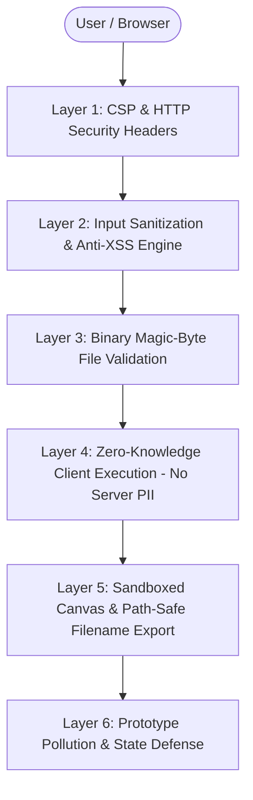

# 💍 Marriage Bio-Data Studio (विवाह बायोडाटा मेकर)

[](https://react.dev/)
[](https://vitejs.dev/)
[](https://tailwindcss.com/)
[-2ea44f?style=for-the-badge&logo=shield)](file:///d:/Bio_Data/src/utils/security.js)
[](#-security--privacy-architecture)
[](#-license)

> **A modern, culturally rich, and security-hardened marriage biodata creation studio.** Create high-definition, publication-grade marriage bio-data profiles with traditional and modern themes, live WYSIWYG editing, and instant print-ready A4 PDF & Ultra-HD PNG downloads — **completely offline-capable and 100% client-side**.

---

## 📑 Table of Contents

- [Overview](#-overview)
- [Key Features](#-key-features)
- [Security & Privacy Architecture](#-security--privacy-architecture)
  - [Layer 1: Content Security Policy & Browser Defense](#layer-1-content-security-policy--browser-defense)
  - [Layer 2: Real-time Input Sanitization & Anti-XSS Engine](#layer-2-real-time-input-sanitization--anti-xss-engine)
  - [Layer 3: Binary Magic-Byte File Validation & Anti-SVG Injection](#layer-3-binary-magic-byte-file-validation--anti-svg-injection)
  - [Layer 4: Zero-Backend / Zero-Knowledge Architecture (PII Protection)](#layer-4-zero-backend--zero-knowledge-architecture-pii-protection)
  - [Layer 5: Sandboxed Canvas Rendering & Safe File Downloads](#layer-5-sandboxed-canvas-rendering--safe-file-downloads)
  - [Layer 6: Prototype Pollution Immunity & State Defense](#layer-6-prototype-pollution-immunity--state-defense)
- [Security Threat Model & Defense Matrix](#-security-threat-model--defense-matrix)
- [Tech Stack](#-tech-stack)
- [Project Architecture & Directory Structure](#-project-architecture--directory-structure)
- [Getting Started](#-getting-started)
  - [Prerequisites](#prerequisites)
  - [Installation](#installation)
  - [Running the App](#running-the-app)
  - [Building for Production](#building-for-production)
- [Configuration & Customization](#-configuration--customization)
- [Privacy Statement](#-privacy-statement)
- [License](#-license)

---

## 🌟 Overview

Marriage profiles contain some of the most sensitive personal data: **full legal names, dates and times of birth, astrological details, ancestral gotras, physical attributes, contact numbers, family occupations, income, and photographs**.

**Marriage Bio-Data Studio** was engineered from the ground up to solve two critical problems:
1. **Aesthetic Excellence**: Replacing outdated, generic Word templates with stunning, culturally curated, pixel-perfect A4 designs suitable for Indian, Vedic, and international matrimonial contexts.
2. **Absolute Data Confidentiality**: Delivering an enterprise-grade security posture with **zero server storage, zero external data collection, and multi-tier defense layers** against injection attacks and file spoofing.

---

## ✨ Key Features

- 🎨 **8 Culturally Curated Themes**:
  - `Golden Filigree`: Ornate gold borders on warm ivory, ideal for traditional weddings.
  - `Royal Rajput`: Deep crimson and gold regality with aristocratic motifs.
  - `Vedic Traditional`: Auspicious turmeric-saffron accents with sacred geometric trims.
  - `Divine Temple`: Spiritual south-Indian temple bronze and sand aesthetic.
  - `Emerald Elegance`: Deep royal emerald green with subtle botanical borders.
  - `Sapphire Royale`: Majestic midnight navy and platinum styling.
  - `Modern Minimalist`: Contemporary editorial design with sleek typography.
  - `Rose Gold Floral`: Romantic blush rose gold with delicate corner motifs.

- 🔤 **Dynamic Multi-Font Typography Pairing**:
  - Switch seamlessly between curated Google Font pairings (Playfair Display, Cinzel, Cormorant Garamond, Outfit, Marcellus, Poppins, Inter, and Noto Sans Devanagari).

- 👁️ **Live WYSIWYG & Inline Editing**:
  - Live side-by-side synchronization between form inputs and preview canvas.
  - Direct on-sheet click-to-edit mode with instant feedback.

- 📄 **Smart Multi-Page & A4 Sheet Pagination**:
  - Automatically calculates content height and provides accurate page estimation.
  - Export single-page, multi-page, or split-page A4 PDFs with perfect alignment.

- 🛡️ **Granular Privacy & Field Toggles**:
  - Show or hide any individual field (e.g., income, horoscope, sub-caste, phone numbers) with a single toggle.

- ⚡ **Instant High-DPI Downloads**:
  - **Vector A4 PDF**: Ready for commercial printing.
  - **Ultra-HD Image (PNG)**: Optimized for WhatsApp, email, and social sharing.

- 📱 **Adaptive Responsive Design**:
  - Fluid desktop dual-column layout with smooth Lenis inertia scrolling.
  - Mobile bottom tab navigation with full-screen preview sheet.

---

## 🛡️ Security & Privacy Architecture

The application implements a defense-in-depth model across **6 distinct security layers**:



### Layer 1: Content Security Policy & Browser Defense
Implemented in [index.html](file:///d:/Bio_Data/index.html) and [vite.config.js](file:///d:/Bio_Data/vite.config.js):
- **Strict Content Security Policy (CSP)**:
  ```http
  default-src 'self';
  script-src 'self' 'unsafe-inline' 'unsafe-eval';
  style-src 'self' 'unsafe-inline' https://fonts.googleapis.com;
  font-src 'self' https://fonts.gstatic.com data:;
  img-src 'self' data: blob: https:;
  connect-src 'self' https: blob: data:;
  object-src 'none';
  base-uri 'self';
  ```
- **X-Content-Type-Options**: Set to `nosniff` to eliminate MIME-type sniffing vulnerabilities.
- **X-Frame-Options / Anti-Clickjacking**: Set to `DENY` to prevent embedding in malicious iframes.
- **Referrer-Policy**: Set to `strict-origin-when-cross-origin` to prevent data leakage in HTTP referrers.
- **Permissions-Policy**: Explicitly disables unused browser hardware APIs:
  `camera=(), microphone=(), geolocation=(), payment=(), usb=()`.

### Layer 2: Real-time Input Sanitization & Anti-XSS Engine
Implemented in [src/utils/security.js](file:///d:/Bio_Data/src/utils/security.js):
- **Tag Stripping & HTML Neutralization**: Strips executable tags (`<script>`, `<iframe>`, `<object>`, `<embed>`, `<svg>`, `<math>`, `<style>`, etc.).
- **Pseudo-protocol Neutralization**: Filters out `javascript:`, `vbscript:`, and `data:text/html` payloads.
- **Inline Event Handler Elimination**: Neutralizes malicious attributes like `onerror=`, `onload=`, `onclick=`.
- **Trojan Source & Unicode Sanitization**: Removes hidden control characters (`\u0000-\u001F`) and directional override exploits (`\u202A-\u202E`, `\u2066-\u2069`) while fully supporting Hindi and regional Devanagari scripts.
- **Length Ceilings**: Enforces bounds on string inputs to prevent memory exhaustion and ReDoS vulnerabilities.

### Layer 3: Binary Magic-Byte File Validation & Anti-SVG Injection
Implemented in [src/utils/security.js](file:///d:/Bio_Data/src/utils/security.js) and [src/components/FormPanel.jsx](file:///d:/Bio_Data/src/components/FormPanel.jsx):
- **SVG Disallowance**: SVGs (`image/svg+xml`) are strictly prohibited because they can embed arbitrary XML scripts and trigger Cross-Site Scripting.
- **Strict MIME Allowlist**: Only `image/jpeg`, `image/png`, and `image/webp` are permitted.
- **Binary Magic-Byte Inspection**: Inspects the first 16 bytes of every uploaded file via `ArrayBuffer` slice before passing it to any reader:
  - **PNG signature**: `89 50 4E 47 0D 0A 1A 0A`
  - **JPEG signature**: `FF D8 FF`
  - **WebP signature**: `RIFF....WEBP`
- Prevents attackers from disguising executables, HTML documents, or script files by merely changing the file extension.
- **File Size Ceiling**: Strictly capped at 5MB with immediate user feedback via toast notifications.

### Layer 4: Zero-Backend / Zero-Knowledge Architecture (PII Protection)
- **100% Client-Side Computing**: The entire application runs directly in the user's browser.
- **Zero Server Uploads**: Sensitive biodata, contacts, and personal photos are **never transmitted** over any network or stored in any remote database.
- **Compliance**: Adheres to the privacy principles of **GDPR** (Article 25: Privacy by Design) and India's **Digital Personal Data Protection (DPDP) Act 2023**.

### Layer 5: Sandboxed Canvas Rendering & Safe File Downloads
Implemented in [src/components/PreviewPanel.jsx](file:///d:/Bio_Data/src/components/PreviewPanel.jsx):
- **CORS Isolation**: `html2canvas` is configured with `useCORS: true` and sandboxed rendering.
- **Filename Sanitization**: Sanitizes exported PDF/PNG names to prevent Path Traversal and filesystem exploitation:
  ```javascript
  const safeName = (formData.fullName || '')
    .trim()
    .replace(/[/\\?%*:|"<>]/g, '')
    .replace(/\s+/g, '_')
    .slice(0, 50);
  ```

### Layer 6: Prototype Pollution Immunity & State Defense
Implemented in [src/utils/security.js](file:///d:/Bio_Data/src/utils/security.js) and [src/App.jsx](file:///d:/Bio_Data/src/App.jsx):
- Blocks keys such as `__proto__`, `constructor`, and `prototype` in state reducers and handlers.
- `sanitizeFormData` creates objects with `Object.create(null)` prototypes during cleaning to prevent prototype tampering.

---

## 📊 Security Threat Model & Defense Matrix

| Threat Vector | Potential Impact | Implemented Defense Layer | Status |
|---|---|---|:---:|
| **Stored / Reflected XSS** | Session hijacking, script execution | Input Sanitization Engine & CSP | 🛡️ Protected |
| **Malicious SVG Upload** | Embedded script execution | SVG format block & MIME allowlist | 🛡️ Protected |
| **MIME Type Spoofing** | Executable disguised as image | Binary Magic-Byte file signature check | 🛡️ Protected |
| **Path Traversal in Downloads** | Arbitrary file overwrite | Strict filename regex sanitizer | 🛡️ Protected |
| **Clickjacking (UI Redressing)** | Unauthorized frame embedding | `X-Frame-Options: DENY` & CSP frame-ancestors | 🛡️ Protected |
| **PII Data Exfiltration** | Sensitive marital data leakage | Zero-server, 100% client-side memory architecture | 🛡️ Protected |
| **Prototype Pollution** | Object hierarchy corruption | Key filtering & prototype-free data maps | 🛡️ Protected |
| **Buffer / Memory DoS** | Client crash from oversize payload | 5MB file limit & string length bounds | 🛡️ Protected |

---

## 💻 Tech Stack

| Category | Technology | Purpose |
|---|---|---|
| **Framework** | [React 19](https://react.dev/) | Component architecture, state hooks, high-performance virtual DOM |
| **Bundler** | [Vite 6](https://vitejs.dev/) | Ultra-fast HMR and optimized production bundling |
| **Styling** | [Tailwind CSS v4](https://tailwindcss.com/) | Modern utility styling and responsive design tokens |
| **PDF Generation** | [jsPDF](https://github.com/parallax/jsPDF) | High-precision vector A4 document compilation |
| **Canvas Engine** | [html2canvas](https://html2canvas.hertzen.com/) | High-resolution DOM-to-canvas rasterizer |
| **Smooth Motion** | [Lenis](https://lenis.darkroom.engineering/) | Hardware-accelerated inertial smooth scroll |
| **Icons** | [Lucide React](https://lucide.dev/) | Clean, accessible vector icons |
| **Notifications** | [React Hot Toast](https://react-hot-toast.com/) | Non-intrusive security and status alerts |

---

## 📁 Project Architecture & Directory Structure

```plaintext
Bio_Data/
├── index.html                   # Entry HTML with security headers, CSP & Google Fonts
├── package.json                 # Project dependencies and script declarations
├── vite.config.js               # Vite configuration with security headers & Tailwind v4
├── public/                      # Static assets (favicons, icons)
├── src/
│   ├── main.jsx                 # Application bootstrapping & root DOM rendering
│   ├── App.jsx                  # Main application controller, state management & layout
│   ├── index.css                # Global CSS rules, typography & print utilities
│   ├── components/
│   │   ├── Header.jsx           # Top branding bar with action shortcuts & sample loader
│   │   ├── MobileNav.jsx        # Responsive bottom navigation bar for mobile devices
│   │   ├── FormPanel.jsx        # Accordion-based input forms with field visibility toggles
│   │   ├── PreviewPanel.jsx     # Live preview canvas, zoom controls & export options
│   │   ├── BiodataSheet.jsx     # High-fidelity A4 sheet layout for all 8 themes
│   │   ├── DownloadModal.jsx    # Modal dialog for page-selection & format options
│   │   └── ResetModal.jsx       # Confirmation dialog for form resetting
│   ├── data/
│   │   └── constants.js         # Theme templates, font configs, default & sample data
│   └── utils/
│       └── security.js          # Magic-byte check, XSS sanitizer & secure storage engine
└── README.md                    # Comprehensive documentation and security manual
```

---

## 🚀 Getting Started

### Prerequisites

Ensure you have [Node.js](https://nodejs.org/) installed:
- Node.js `v18.0.0` or higher recommended
- npm `v9.0.0` or higher

### Installation

1. Clone or navigate to the repository directory:
   ```bash
   cd d:/Bio_Data
   ```

2. Install all dependencies:
   ```bash
   npm install
   ```

### Running the App

Start the local development server:
```bash
npm run dev
```

Open your browser at `http://localhost:5173/` (or the network URL displayed in the terminal).

### Building for Production

Compile an optimized production build:
```bash
npm run build
```

The compiled assets will be placed in the `dist/` directory.

To preview the production build locally:
```bash
npm run preview
```

---

## 🎨 Configuration & Customization

### Adding a New Template Theme
To introduce a new cultural theme, edit [src/data/constants.js](file:///d:/Bio_Data/src/data/constants.js) and add an entry to the `TEMPLATES` array:

```javascript
{
  id: 'royal_amethyst',
  name: 'Royal Amethyst',
  tagline: 'Deep Purple & Shimmering Gold',
  icon: 'Crown',
  colors: {
    primary: '#4c1d95',
    secondary: '#7c3aed',
    accent: '#f59e0b',
    border: '#c084fc',
    bg: '#faf5ff',
    cardBg: '#ffffff',
    text: '#1e1b4b',
    muted: '#6b7280',
    lightBorder: '#e9d5ff',
  },
  borderStyle: 'ornate',
  headerStyle: 'arch',
}
```

### Adding New Fields
1. Define the field key in `DEFAULT_DATA` within [src/data/constants.js](file:///d:/Bio_Data/src/data/constants.js).
2. Add its user-friendly label to `FIELD_LABELS`.
3. Add the input control in [src/components/FormPanel.jsx](file:///d:/Bio_Data/src/components/FormPanel.jsx).
4. Render the field in the corresponding section of [src/components/BiodataSheet.jsx](file:///d:/Bio_Data/src/components/BiodataSheet.jsx).

---

## 🔒 Privacy Statement

This application does not collect, log, transmit, or monetize any user information:
- **No Analytics Trackers**: No Google Analytics, Facebook Pixel, or third-party telemetries.
- **No Cloud Uploads**: Photos and bio-data details exist strictly within temporary browser RAM.
- **Client Processing**: Canvas conversions and PDF compilation happen locally on your CPU/GPU.

---

## 📄 License

This project is licensed under the [MIT License](LICENSE). Feel free to use, modify, and distribute for personal and commercial purposes.

---

*Crafted with passion for traditional elegance, privacy, and modern web security.*
